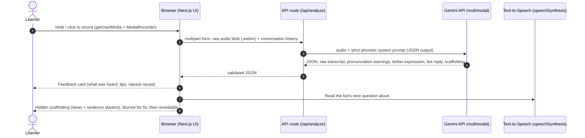
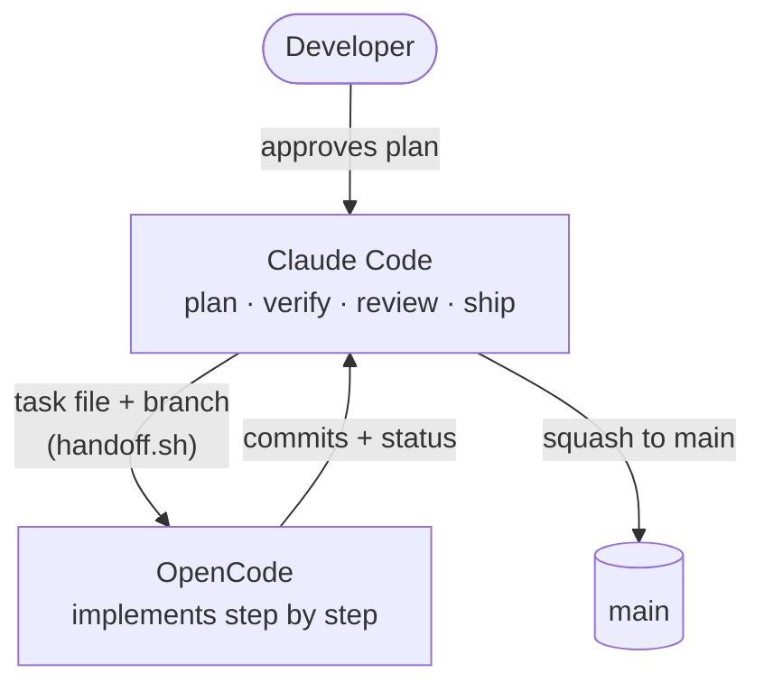

# AI English Speaking Coach

A web app for practicing spoken English, built for learners who read and listen well (~80% passive comprehension) but blank out when speaking and are unsure about pronunciation.

> **Status:** early development. The scaffold is in place; the audio API, recorder and feedback UI are being built task by task.

## Why it works differently

Standard speech-to-text (and real-time voice modes) auto-correct mispronounced words from context, which hides exactly the mistakes a learner needs to see. This app instead:

1. records **raw audio** in the browser (`MediaRecorder`, `.webm`), and
2. sends the audio file **directly to a multimodal LLM (Gemini)**, which is told to transcribe what it *actually heard*, without context-based correction, and flag mispronounced words or missing ending sounds.

## How the parts work together



| Part | Responsibility |
|---|---|
| **Browser** | Records audio, keeps the conversation state, renders feedback and scaffolding, plays TTS. |
| **API route** | Stateless. Receives audio + history, calls Gemini, validates and returns the JSON. Holds the API key. |
| **Gemini** | Listens to the waveform, returns phonetic transcript, warnings, recast and the next bot turn. |
| **TTS** | Browser-native `speechSynthesis` reads the bot's questions aloud. |

### Response shape

```json
{
  "user_analysis": {
    "raw_transcript": "what the model actually heard",
    "pronunciation_warnings": [{ "heard": "...", "intended": "...", "tip": "..." }],
    "better_expression": "natural English version (Vietnamese mixed in is translated)"
  },
  "bot_reply": {
    "text": "reply and next question",
    "hidden_scaffolding": { "ideas": ["..."], "sentence_starters": ["..."] }
  }
}
```

Types live in `lib/types.ts`. The full spec is in [`BLUEPRINT.md`](BLUEPRINT.md).

## Teaching principles

- **Scaffolding:** every bot turn carries 2–3 idea hints and sentence starters, blurred for 5 seconds to encourage recall.
- **Code-switching & recasting:** mixing Vietnamese is welcome; the bot recasts it into natural English, never scolds.
- **Micro-correction:** at most 1–2 pronunciation/grammar fixes per turn.

## Getting started

```bash
npm install
cp .env.example .env.local   # then set GEMINI_API_KEY
npm run dev                  # http://localhost:3000
```

| Variable | Description |
|---|---|
| `GEMINI_API_KEY` | Key from [Google AI Studio](https://aistudio.google.com/apikey) (free tier is enough for development). |
| `GEMINI_FALLBACK_MODEL` | Optional second model tried when the first returns 503/504 or times out (default `gemini-3.6-flash`). |
| `GEMINI_MODEL` | Gemini model id, default `gemini-3.5-flash-lite` (fast). Never hardcoded; change it here. |

Scripts: `npm run typecheck`, `npm run lint`, `npx playwright test` (uses a fake microphone and never calls the real Gemini API).

## Tech stack

Next.js (App Router) · TypeScript · Tailwind CSS · lucide-react · Gemini API · Playwright

## How this repo is built (Claude + OpenCode)

Development is split between two coding agents using [claude-opencode-kit](https://github.com/trgianghuynh1808/claude-opencode-agentic-kit): **Claude Code** plans, verifies, reviews and ships; **OpenCode** writes the code. They communicate only through the repo.



| File | Role |
|---|---|
| `AGENTS.md` | Stable project knowledge shared by all agents. |
| `CLAUDE.md` | Claude-only workflow: plan format, hand-off, review, ship. |
| `.agents/tasks/*.md` | One file per task: plan, context, test cases, status, verification. |

## License

TBD.
