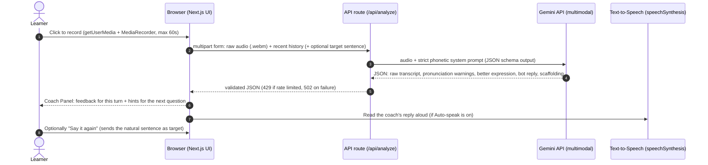

# AI English Speaking Coach

A web app for practicing spoken English, built for learners who read and listen well (~80% passive comprehension) but blank out when speaking and are unsure about pronunciation.

> **Status:** working end to end and intended for local, single-user use (no deployment or accounts). You speak, get pronunciation feedback and a natural recast, and the coach keeps the conversation going.

## Why it works differently

Standard speech-to-text (and real-time voice modes) auto-correct mispronounced words from context, which hides exactly the mistakes a learner needs to see. This app instead:

1. records **raw audio** in the browser (`MediaRecorder`, `.webm`), and
2. sends the audio file **directly to a multimodal LLM (Gemini)**, which is told to transcribe what it *actually heard*, without context-based correction, and flag mispronounced words or missing ending sounds.

## Features

- **Two-column layout:** the chat shows only the dialogue; a **Coach Panel** beside it holds **Hints** (above) and **Feedback** (below). Click any of your turns to see the feedback for that turn.
- **Feedback in three parts:** *What we heard* (raw transcript, no auto-correction), *Fix these* (`heard → intended` with a tip, at most 2 per turn) and *Say it naturally* (a polished version, with a **Listen** button).
- **Say it again:** repeat the natural sentence; the app compares what you said with that target, again without auto-correcting.
- **Hints / scaffolding:** every coach question comes with 2–3 ideas and sentence starters, blurred for 5 seconds to encourage recall (or **Reveal now**).
- **Code-switching:** mixing Vietnamese is welcome; it is recast into natural English, never scolded.
- **Listening practice:** the coach reads replies aloud (**Auto-speak** toggle, plus a **Listen** button on every coach message), and **Play my recording** replays your own voice.
- **Persistence:** the conversation and the Auto-speak preference are saved in the browser (`localStorage`); **New conversation** resets it.
- **Resilience:** one attempt per model with an automatic fallback model on 503/504, and a friendly "slow down" lock when the free-tier rate limit (429) is hit.

## How the parts work together



| Part | Responsibility |
|---|---|
| **Browser** | Records audio, keeps the conversation state (saved in `localStorage`), renders chat, feedback and hints, plays TTS and your own recording. |
| **API route** | Stateless. Receives audio + history (+ optional `target`), calls Gemini, validates and returns the JSON. Holds the API key. |
| **Gemini** | Listens to the waveform, returns the phonetic transcript, warnings, recast and the next coach turn. |
| **TTS** | Browser-native `speechSynthesis` (en-US voice) reads the coach's messages aloud. |

### API

`POST /api/analyze` (`multipart/form-data`)

| Field | Required | Description |
|---|---|---|
| `audio` | yes | An `audio/*` file, up to 10 MB (the browser sends `audio/webm`). |
| `history` | no | JSON array of `{ "role": "user" \| "bot", "text": "..." }`; the last 6 turns are used. |
| `target` | no | Sentence the learner is repeating (max 300 characters). |

Responses: `200` with the JSON below, `400` for invalid input, `413` for oversized audio, `429` (`rate_limited`) when Gemini rate-limits, `502` for other failures.

```json
{
  "user_analysis": {
    "raw_transcript": "what the model actually heard",
    "pronunciation_warnings": [{ "heard": "...", "intended": "...", "tip": "..." }],
    "better_expression": "natural English version (Vietnamese mixed in is translated)"
  },
  "bot_reply": {
    "text": "reply and next question",
    "hidden_scaffolding": { "ideas": ["..."], "sentence_starters": ["..."] }
  }
}
```

Types live in `lib/types.ts`. The full spec is in [`BLUEPRINT.md`](BLUEPRINT.md).

## Teaching principles

- **Scaffolding:** every coach turn carries 2–3 idea hints and sentence starters, blurred for 5 seconds to encourage recall.
- **Code-switching & recasting:** mixing Vietnamese is welcome; the coach recasts it into natural English, never scolds.
- **Micro-correction:** at most 1–2 pronunciation/grammar fixes per turn.

## Getting started

```bash
npm install
cp .env.example .env.local   # then set GEMINI_API_KEY
npm run dev                  # http://localhost:3000
```

Open the app in Chrome and allow microphone access. `localhost` counts as a secure context, so no HTTPS is needed.

| Variable | Description |
|---|---|
| `GEMINI_API_KEY` | Key from [Google AI Studio](https://aistudio.google.com/apikey). The free tier is enough for personal use (roughly 5 requests per minute per model). |
| `GEMINI_MODEL` | Gemini model id, default `gemini-3.5-flash-lite` (fast). Never hardcoded; change it here. |
| `GEMINI_FALLBACK_MODEL` | Optional second model tried when the first returns 503/504 or times out (default `gemini-3.6-flash`). |

Restart `npm run dev` after changing `.env.local`.

### Scripts

| Command | What it does |
|---|---|
| `npm run dev` | Start the dev server on port 3000. |
| `npm run typecheck` / `npm run lint` | Type check and ESLint. |
| `npx playwright test` | End-to-end tests with a fake microphone; Gemini is mocked, the real API is never called. **Stop the dev server first**, otherwise Playwright reuses it and the API tests would hit real Gemini. |

## Project structure

```
app/                       page and the /api/analyze route
components/
  Conversation.tsx         state and flow (record, analyze, speak, save)
  conversation/            ChatThread, CoachPanel, Toolbar
  Recorder.tsx, FeedbackCard.tsx, ScaffoldingBox.tsx, SpeakButton.tsx, PlayRecording.tsx
lib/                       Gemini client, prompt, validation, recorder and speech hooks, storage, types
tests/                     Playwright specs
```

## Tech stack

Next.js (App Router) · TypeScript · Tailwind CSS · lucide-react · Gemini API (`@google/genai`) · Playwright

## How this repo is built (Claude + OpenCode)

Development is split between two coding agents using [claude-opencode-agentic-kit](https://github.com/trgianghuynh1808/claude-opencode-agentic-kit): **Claude Code** plans, verifies, reviews and ships; **OpenCode** writes the code. They communicate only through the repo.


| File | Role |
|---|---|
| `AGENTS.md` | Stable project knowledge shared by all agents. |
| `CLAUDE.md` | Claude-only workflow: plan format, hand-off, review, ship. |
| `.agents/tasks/*.md` | One file per task: plan, context, test cases, status, verification. |

## License

TBD.
